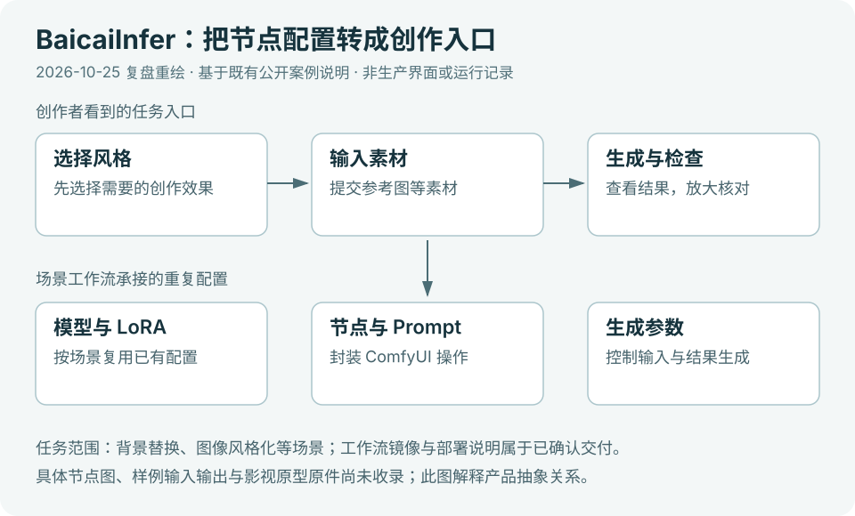
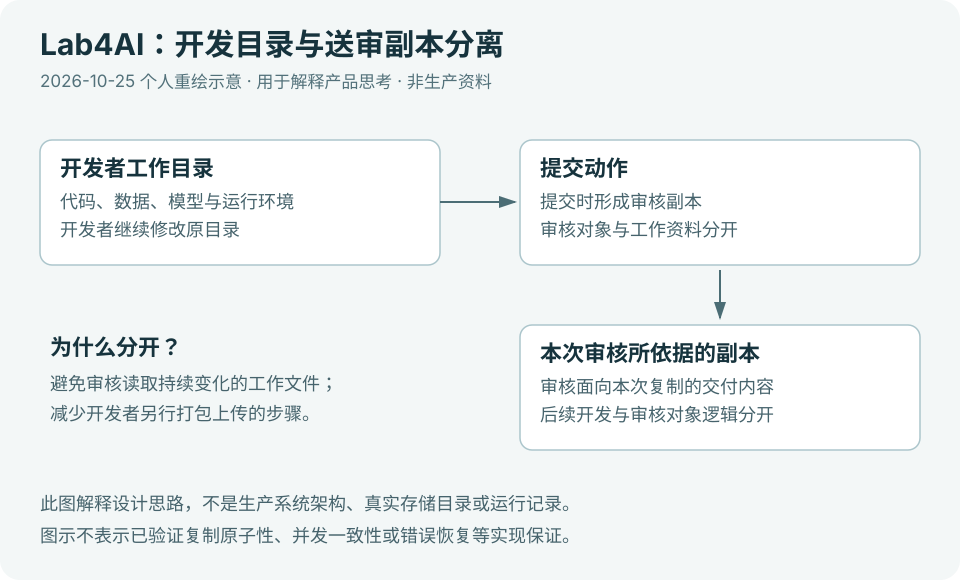

# AI 产品作品集

围绕真实任务，记录 AI 工作流、应用、开发者平台与预测研究中的产品设计、工程交付和验证过程。

- [Multi-Skill Content Agent](#multi-skill-content-agent) · 个人工作流，真实内容产物
- [StayWord](#stayword) · iOS 已上架，可下载体验
- [BaicaiInfer](#baicaiinfer) · 创作者工具，项目实践复盘
- [Lab4AI](#lab4ai) · 开发者工具，项目实践复盘
- [RiverSR](#riversr) · 预测研究，已有正式模型与结果
- [PriceMap AI](#pricemap-ai) · 网站已上线，可在线查询

## Multi-Skill Content Agent

**内容生产 Skills 与任务工作流**

创作者把视频、口播稿或产品资料制作成一期内容，需要在理解、正文、图片和发布素材之间交接。我用共享分析、按需调用与文件检查组织四类独立任务，让修改能继续传递到交付。已有真实卡片、分步演示、文案、封面和草稿；由用户选择路径，尚无跨模块统一调度器。

[阅读案例](projects/01-content-agent/README.md) · [查看四类交付](projects/01-content-agent/demo/README.md) · [技术架构](projects/01-content-agent/docs/architecture.md)

## StayWord

**端侧 AI 录音笔记**

录音之后，用户还需要找到原话、理解重点和带走资料。StayWord 将原音频、转写、摘要与回听放在同一条记录里，以本地核心处理支持个人谈话整理。iOS 已上架并完成倍速、三类导出等反馈迭代；端侧模型的等待、资源与事实质量分别验证。

[阅读案例](projects/02-stayword/README.md) · [App Store](https://apps.apple.com/app/id6795797415) · [实机演示](projects/02-stayword/demo/README.md)

## BaicaiInfer

**创作者工具产品实践**

创作者需要从模型、节点和参数中找到适合自己的生成方式。我参与创作场景梳理、工作流交付、用户反馈整理与需求推进，重点思考如何将技术配置转化为易理解的创作选择，以及如何让生成结果进入后续创作。

[阅读实践复盘](projects/05-baicaiinfer/README.md)

## Lab4AI

**开发者工具产品实践**

模型在开发者环境中运行成功之后，还需要让他人能够检查和接手。我参与复现流程与交付要求设计，并亲自部署、运行和核对模型结果，从任务完成标准、成果送审与协作交接三个方面复盘产品设计。

[阅读实践复盘](projects/06-lab4ai/README.md)

## RiverSR

**河水锶同位素预测与模型评估**

实测站点无法覆盖所有河流，研究者需要知道预测能支持什么判断。我以环境数据建立基线，通过水系隔离、误差诊断与配对实验决定模型用途和新增信息是否值得采用。已有正式模型与原始留出结果；生物应用仍待验证，地图另保留为合成数据原型。

[阅读研究案例](projects/03-riversr/README.md) · [真实结果与模型](projects/03-riversr/demo/README.md) · [研究决策时间线](projects/03-riversr/docs/decision-timeline.md)

## PriceMap AI

**AI 服务报价查询与比较**

选购订阅或接入 API 时，报价分散、规格和计费条件难以比较。我用两条查询路径、确定性归一和持续快照发布集中候选，保留原站核对入口。网站已上线；历史回放显示目录覆盖已有基础，严格同规格比较仍受限，下一步优先改善规格与标签质量。

[阅读案例](projects/04-pricemapai/README.md) · [体验网站](https://pricemapai.com) · [双路径演示](projects/04-pricemapai/demo/README.md)
