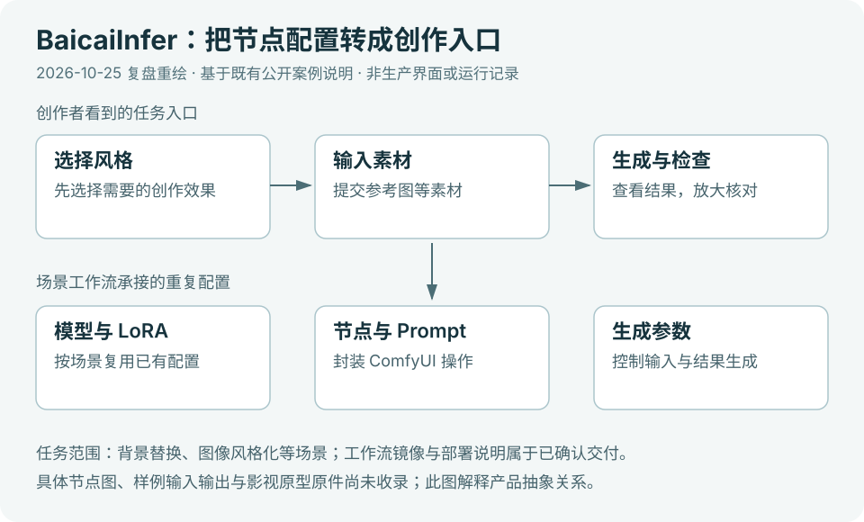

# BaicaiInfer · 创作者工具产品实践

**让创作者围绕目标效果作选择，并能判断和继续使用生成结果。**

我参与过 BaicaiInfer 的创作场景梳理、工作流交付、用户反馈与产品需求推进。本页围绕个人职责和通用产品判断复盘历史实践，不提供项目代码、生产界面或业务数据，也不代表当前在线服务。

[返回作品集](../../README.md) · [开发者工具实践：Lab4AI](../06-lab4ai/README.md)

## 把技术选项翻译成创作选择

图为个人重新绘制的机制示意，用于解释设计思路，不是生产界面或真实节点配置。

创作者首先关心“想做成什么样、需要准备什么、结果怎样继续用”。技术选项可以提供控制，但选项越多，理解和试错负担也可能增加。我在这类工作中关注场景梳理与需求表达，让讨论从模型和参数回到用户要完成的任务。

我的通用判断是：优先展示与当前任务直接相关的选择，解释输入条件和结果预期；更细的控制应当有明确用途，而不是因为底层支持就全部放进入口。简化操作的同时，也要保留用户判断效果和调整方向的空间。

## 把反馈还原为一个具体阻碍

“生成不好用”可能意味着效果不符，也可能是输入难准备、等待状态不清楚，或结果难以检查和取用。这些问题需要不同的产品响应，不能全部归结为模型质量。

我参与用户反馈跟进与需求推进时，重视追问三个问题：用户原本想完成什么，在哪一步被阻断，怎样的变化才算解决。接着比较它对核心任务的影响、适用范围和协作成本，再形成需求讨论。这里呈现的是我的分析方法，不逐项还原内部功能和版本。

## 交付之外，还要让结果进入后续工作

一次生成可以结束于“得到结果”，创作任务却往往还要核对、修改和复用。我的产品思考因此同时关注入口控制和结果使用：用户是否知道选项的含义，能否判断产物是否符合目标，修改后是否还拿得到所需材料。

我承担的范围包括场景与工作流交付、反馈整理和需求推进；平台研发与整体业务成果不等同于个人独立完成。本页不以一般方法替代某项功能已上线、某个体验收益已被测量的证明。

## 复盘范围

本页关注个人参与与通用产品判断，不还原内部设计，也不把方法讨论当作某项具体功能效果的验证。
