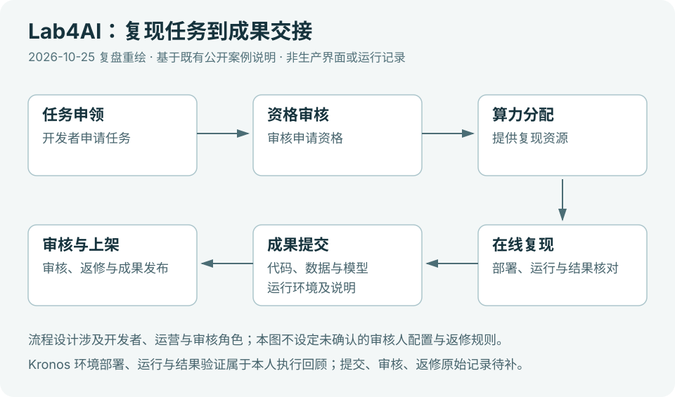
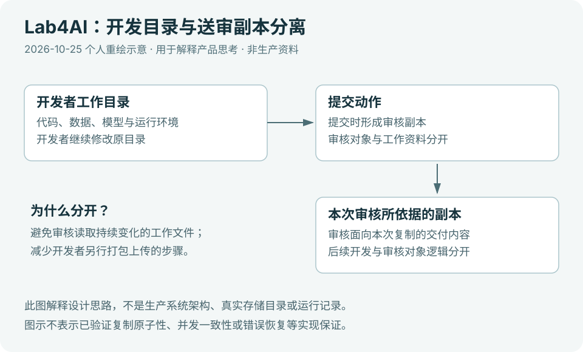

# Lab4AI · 开发者工具产品实践

**明确模型复现的完成条件，让成果能够被检查和接手。**

我参与开发者复现流程与交付要求设计，也亲自进行模型环境部署、运行和结果核对。以下复盘这段项目实践中的任务标准与协作设计，配图为设计示意。

[返回作品集](../../README.md) · [创作者工具实践：BaicaiInfer](../05-baicaiinfer/README.md)

## 从运行成功到成果交接

开发者在自己的环境中运行成功之后，接手者还需要理解输入、环境、启动方式与结果。因此，流程设计需要提前明确每个阶段的完成条件。

我参与流程与交付要求设计时，关注任务申领、资源准备、执行、提交与审核之间的信息衔接：开发者开始前要知道交付什么，审核者接手时要知道检查什么。

这里的取舍是交付完整度与准备成本。要求过少，解释与返工留到交接之后；要求过重，又会增加开发者负担。材料应围绕接手者的实际操作组织，每一项都有明确用途。

## 用实际部署检查要求是否可执行

亲自部署、运行和核对模型结果，让我接触到依赖、资源、启动条件与结果理解之间的衔接问题。说明如果默认太多经验，初次使用者就很难判断自己缺少条件，还是操作出了问题。

我据此从执行者视角检查交付要求：前置条件是否明确、步骤是否能理解、失败后能否找到下一步，以及完成后是否有可核对的结果。产品要求需要经得起实际操作，才能成为有效的协作约定。

## 将持续开发与本次审核分开

开发者可能在提交后继续修改，审核者则需要一个确定的检查对象。两者使用同一份持续变化的资料，容易造成版本理解不一致。

图示表达一种交接设计：提交时形成面向本次审核的副本，开发者继续维护工作资料，审核围绕已提交内容进行。它将持续修改与阶段验收分开，也减少另行打包交接的操作。

我在该项目中的参与范围是流程与交付要求设计，以及本人执行的部署、运行和核对。产品设计的重点是明确各方需要作出的判断，再安排信息与交接方式，减少版本歧义和反复解释。
